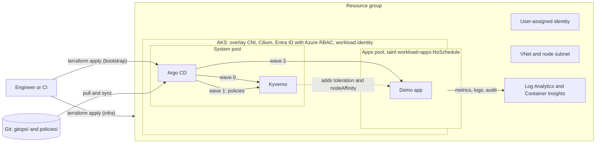

# aks-gitops-starter

An opinionated starting point for running workloads on Azure Kubernetes Service. Terraform builds a cluster with the security and operations defaults I would expect on day one: Entra ID login with Azure RBAC and no local admin account, workload identity, Azure CNI overlay with Cilium, a restricted API server, scheduled upgrades and Container Insights. A second Terraform root installs Argo CD and hands everything else to git: Kyverno, a small set of policies, and a demo app pinned to a dedicated node pool. The aim is a cluster you can explain line by line, not one that does everything.

## Architecture



## What you get

| Path | Contents |
| --- | --- |
| `infra/` | Terraform root for the platform: resource group, VNet and subnet, user-assigned cluster identity, AKS, a tainted user node pool, Log Analytics with a Container Insights data collection rule, control plane diagnostic logs, Azure RBAC role assignments for cluster admins. |
| `infra/bootstrap/` | Second Terraform root. Installs Argo CD with the Helm provider and creates the root Application of the app-of-apps tree. Terraform owns nothing else in the cluster. |
| `gitops/apps/` | The app-of-apps: a small Helm chart that renders one Argo CD Application each for Kyverno, the policies and the demo app, ordered by sync waves. |
| `gitops/workloads/demo/` | nginx (unprivileged image) with a toleration and nodeSelector for the apps pool, probes, a PodDisruptionBudget and a locked-down security context. |
| `policies/` | Kyverno policies: three validations and one mutation, all in Audit mode. `policies/tests/` holds `kyverno test` cases that run in CI. |
| `.github/workflows/ci.yml` | `terraform fmt`, `init -backend=false`, `validate` and `tflint` for both roots, then `yamllint`, `helm lint` and `helm template`, `kubeconform` and `kyverno test`. |

### Cluster settings at a glance

- Kubernetes authentication through Entra ID, authorisation through Azure RBAC, `local_account_disabled = true`. Nobody holds a static admin kubeconfig.
- OIDC issuer and workload identity enabled. The issuer URL is an output.
- Azure CNI overlay with the Cilium data plane and network policy.
- API server reachable only from `api_server_authorized_ip_ranges`. The variable is required.
- System pool (2 to 3 nodes) and an `apps` user pool (1 to 5 nodes), both autoscaled, spread over three zones, ephemeral OS disks.
- `automatic_upgrade_channel = "patch"` and `node_os_upgrade_channel = "NodeImage"`, both confined to a weekly maintenance window.
- Container Insights through managed identity, ContainerLogV2, and `kube-audit-admin` plus `guard` control plane logs. The workspace has a daily ingestion cap.
- Image cleaner on, every 48 hours.

## Quick start

Prerequisites: Terraform 1.6 or later, Azure CLI, `kubelogin`, `kubectl`. Your account needs to create resources and role assignments on the subscription (Owner, or Contributor plus User Access Administrator).

```bash
az login
az account set --subscription "<subscription-id>"
export ARM_SUBSCRIPTION_ID="$(az account show --query id -o tsv)"

# 1. Platform
cd infra
cp terraform.tfvars.example terraform.tfvars   # set api_server_authorized_ip_ranges to your IP
terraform init
terraform apply

# 2. GitOps bootstrap (fork this repo first and point gitops_repo_url at the fork)
cd bootstrap
cp terraform.tfvars.example terraform.tfvars
terraform init
terraform apply

# 3. Look around
eval "$(terraform -chdir=.. output -raw get_credentials_command)"
kubectl -n argocd get applications
kubectl get pods -n demo -o wide          # scheduled on aks-apps-* nodes
kubectl get policyreports -A              # audit results from Kyverno
```

New Azure RBAC role assignments can take a minute or two to apply. If the bootstrap apply fails with a 403 straight after the first apply, wait and run it again.

The Argo CD UI is not exposed. `terraform output argocd_ui_command` prints the port-forward command and `terraform output argocd_initial_password_command` prints how to read the initial password.

### Linting locally

```bash
terraform fmt -recursive -check infra
tflint --init --config "$PWD/.tflint.hcl"
(cd infra && tflint --config "$PWD/../.tflint.hcl")
(cd infra/bootstrap && tflint --config "$PWD/../../.tflint.hcl")
kyverno test policies/tests
```

## Design decisions

**Azure CNI overlay with Cilium.** With classic Azure CNI every pod takes an IP from the VNet, so subnet sizing becomes capacity planning and large clusters exhaust address space. In overlay mode only nodes take VNet IPs and pods use a private range (`pod_cidr`), which keeps the subnet a /22 and leaves room for peering. Cilium provides the data plane and enforces Kubernetes NetworkPolicy without a separate policy engine.

**Workload identity, user-assigned cluster identity, no local accounts.** Pods that need Azure access get it by federating their service account with an Entra ID identity, so there are no client secrets in the cluster to rotate or leak. The cluster's own identity is user-assigned so it can be granted rights on the subnet before the cluster exists and survives a cluster rebuild. Local accounts are disabled so every `kubectl` call is tied to a person or a workload and shows up in the `guard` and audit logs.

**A tainted user pool plus a Kyverno mutation.** The system pool runs Kubernetes add-ons and the platform tools (Argo CD, Kyverno). Application pods go to a separate `apps` pool that carries the taint `workload=apps:NoSchedule`, so a noisy or broken app cannot starve the components that keep the cluster running, and the two pools can be sized, scaled and upgraded independently. A taint alone only keeps pods out; it does not pull them in. The mutation policy closes that gap: any pod created in a namespace labelled `workload-tier=apps` gets the toleration and a required nodeAffinity for `workload=apps`. Teams label their namespace and never deal with pool names. A pod that sets its own nodeAffinity keeps it. The policy mutates pods, not Deployments, so manifests in git stay as written and Argo CD reports no drift.

**Audit first.** The validation policies start with `validationActions: [Audit]`. Turning on enforcement on a cluster that already runs workloads tends to break deployments nobody expected, so the first step is to see what would fail. To move a policy to enforcement:

1. Check the reports: `kubectl get policyreports -A` and `kubectl get clusterpolicyreports`.
2. Fix the workloads, or add a narrowly scoped `PolicyException` where there is a real reason.
3. Change `validationActions` to `[Deny]` (or `[Deny, Audit]` to keep reporting) and, once Kyverno runs with several replicas, set `failurePolicy: Fail`.

The policies use the CEL-based `policies.kyverno.io/v1` API (`ValidatingPolicy`, `MutatingPolicy`). The older `kyverno.io/v1 ClusterPolicy` is deprecated as of Kyverno 1.19.

**Sync waves and Application health.** Kyverno is wave 0, the policies wave 1 and the demo wave 2. Argo CD only waits between waves on resources that report health, and it does not report health for `Application` resources by default, so the bootstrap adds the documented Lua health check to `argocd-cm`. Without it the policies could be applied before the Kyverno CRDs exist.

**Two Terraform roots.** The cluster and what runs on it change at different speeds and need different credentials. Keeping them apart means a cluster change never plans against the Kubernetes API, and a failed Helm install never leaves the infrastructure state half applied. After bootstrap, Terraform owns a single Kubernetes object, the root Application. Everything else changes through git.

**The repository URL lives in one place.** `gitops/apps` is a Helm chart, so the root Application passes `repoURL` and `targetRevision` down to the child Applications. Forking the repo means setting one Terraform variable.

## Cost

Rough estimate only, pay-as-you-go list prices, USD per month, defaults as shipped. Prices change and differ by region: check the [Azure pricing calculator](https://azure.microsoft.com/pricing/calculator/) before relying on these.

| Item | Rough monthly estimate |
| --- | --- |
| 3 x Standard_D2ads_v5 nodes at the autoscaler minimum (2 system, 1 apps) | 200 to 300 |
| AKS control plane, Free tier (Standard tier adds about 73 for the uptime SLA) | 0 |
| Standard load balancer and outbound public IP | 20 to 30 |
| Log Analytics ingestion, capped at 2 GB a day | 0 to 170, usually far less for an idle cluster |

Scaling the apps pool to zero when idle (`apps_node_pool.min_count = 0`) and keeping the daily log cap are the two easiest levers.

## Clean-up

The cluster holds everything Argo CD installed, so destroying the infra root removes all of it:

```bash
terraform -chdir=infra destroy
rm -f infra/bootstrap/terraform.tfstate*   # its only target was the cluster that no longer exists
```

The Log Analytics workspace stays recoverable for 14 days after deletion. Recreating it with the same name in that period restores it.

## What I would add for production

- **Private cluster** (or API server VNet integration) and access through a jump host, VPN or private build agents, instead of authorized IP ranges.
- **Egress through Azure Firewall** with `outbound_type = "userDefinedRouting"`, so outbound traffic is filtered and comes from known IPs.
- **Key Vault through the Secrets Store CSI driver**, authenticated with workload identity, for application secrets.
- **Backups** with AKS Backup or Velero for cluster state and persistent volumes, with a tested restore.
- **Standard tier** for the uptime SLA, a system pool of at least three nodes, and Kyverno and Argo CD in their HA layouts.
- **Entra ID SSO for Argo CD**, the local admin user disabled, and one AppProject per team instead of `default`.
- **Remote state** in a locked-down storage account (example in each `backend.tf`), one state per environment, plans run from CI.
- **Container registry** (ACR) with `AcrPull` for the kubelet identity, plus an image policy for allowed registries and signatures.
- **Managed Prometheus and Grafana**, alerts on node pressure, pod restarts and failed syncs.
- **Policies in Deny mode**, plus Pod Security Standards restricted profile rules beyond the baseline ones here.

## License

MIT. See [LICENSE](LICENSE).
